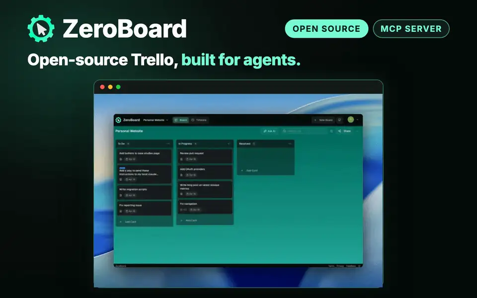
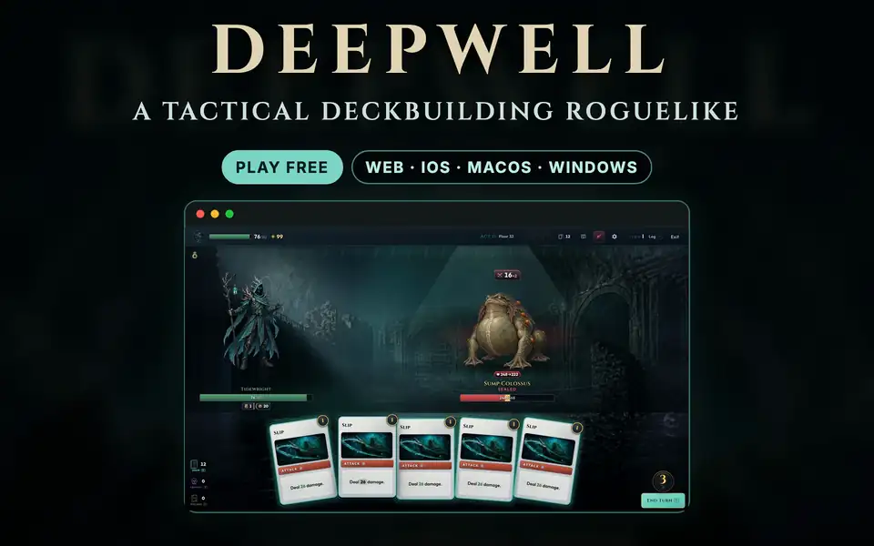

<table width="100%">
  <tr>
    <td valign="middle">
      <a href="https://x.com/hodlmecloseplz" title="X"><picture><source media="(prefers-color-scheme: dark)" srcset="https://cdn.simpleicons.org/x/ffffff"></picture></a>
      
      
      <b>Hey, I'm Trent 👋</b> 
      I run a fleet of coding agents like an engineering team, and I hold what they ship to a principal engineer's bar.
      Founder of <a href="https://zeroclickdev.ai/">Zero Click Dev</a>.
        
      
    </td>
  </tr>
  <tr>
    <td align="center">
      
       
      
      
       
      
      
       
      
      
    </td>
  </tr>
  <tr>
    <td>
      <b>how i work</b>  
      🧪 <b>Experiment fast</b> 
      45+ repos started in 2026: products, MCP servers, games, client sites, and research spikes. 
       
      📈 <b>Hill-climb with evals</b> 
      I build evals and benchmarks, then climb them: UI quality, game feel, API contracts, and infrastructure. 
       
      🔍 <b>Quality-control the agents</b> 
      Review panels across models and verification against the real app before anything is called done. Reviewers get a narrated video of each PR instead of a wall of text. 
       
      💸 <b>Run lean</b> 
      I optimize cloud cost hard. Most of my projects run free on hobby tiers. 
       
      🖥️ <b>Ship beyond the web</b> 
      Native desktop apps (Tauri, Electron), iOS, and Windows builds, with CI pipelines that build them as development happens. 
       
      🎬 <b>Launch it, not just ship it</b> 
      Every product gets a launch: agents help me make the product launch videos, marketing creatives, and social campaigns. My team's demo videos have reached leadership. 
       
      🛡️ <b>Govern it</b> 
      AI governance, CI that agents can't skip, and maintenance loops that keep every repo current. 
       
      🤝 <b>Lead with humility, grace, and being genuine</b> 
    </td>
  </tr>
  <tr>
    <td>
      <b>shipping</b>  
      <a href="https://github.com/tmcfarlane/team-avatar"><b>Team Avatar</b></a>   
      A universal agent harness for developers. 9 agents and 58 skills that work in any agentic dev environment.  
      <a href="https://github.com/tmcfarlane/flowchart"><b>Flowchart AI</b></a>    
      Describe the flow, get the visual. Your agent can draw and edit charts over MCP.  
      <a href="https://github.com/tmcfarlane/zeroclickboards"><b>ZeroBoard</b></a>   
      An open-source Trello your agent can plan, track, and ship from.  
      <a href="https://replyguy.zeroclickdev.ai/"><b>ReplyGuy</b></a>  
      One-click AI replies for LinkedIn and Gmail, in your voice.  
      <a href="https://wordgarden.zeroclickdev.ai/"><b>Word Garden</b></a>  
      A local-first writing app for long-form fiction. No sign-in, bring your own AI key.  
      <a href="https://deepwell-eight.vercel.app/"><b>DEEPWELL</b></a>  
      A tactical deckbuilding roguelike on web, iOS, macOS, and Windows.  
      <a href="https://dustline-eight.vercel.app/"><b>DUSTLINE</b></a>  
      Trials-style dirt-bike racing in the browser, with touch controls and custom physics.  
      <b>Neon Felt</b>  
      Real-time multiplayer poker with an authoritative game server.
    </td>
  </tr>
  <tr>
    <td>
      

        
<b>My AI Experience Timeline</b> 2017 → today

         
        <picture>
          <source media="(prefers-color-scheme: dark)" srcset="assets/timeline-dark.webp" />
          
        </picture>
      

    </td>
  </tr>
  <tr>
    <td>
      <b>agents i drive</b> 
      Daily drivers: Claude Code, Codex, and OpenCode, all voice-first through SuperWhisper. 
       
      
      
      
      
      
      
      
      
      
      
      
    </td>
  </tr>
  <tr>
    <td>
      <b>what i build with</b> 
      
      
      
      
      
      
      
      
      
      
      
      
      
      
      
      
      
    </td>
  </tr>
  <tr>
    <td>
      <b>open source i recommend</b>  
      <a href="https://github.com/michael-denyer/pstack-claude">pstack-claude</a> 
      poteto's pstack for Claude Code, Codex, Gemini, and more. Principles and playbooks for rigorous work.  
      <a href="https://github.com/t3dotgg/tstack">tstack</a> 
      Theo's agent skills, the ones he uses every day in Claude Code and Codex.  
      <a href="https://github.com/mattpocock/skills">mattpocock/skills</a> 
      skills for real engineers, straight from Matt Pocock's <code>.agents</code> directory.  
      <a href="https://github.com/garrytan/gbrain">garrytan/gbrain</a> 
      Garry Tan's opinionated agent brain for OpenClaw and Hermes.  
      <a href="https://github.com/pingdotgg/t3code">T3 Code</a> 
      Theo's app for driving Claude Code, Codex, and more from any computer or phone.  
      <a href="https://github.com/Yeachan-Heo/oh-my-claudecode">oh-my-claudecode</a> 
      teams-first multi-agent orchestration for Claude Code.  
      <a href="https://github.com/ghuntley/how-to-ralph-wiggum">Ralph Wiggum</a> 
      Geoffrey Huntley's loop technique. See also <a href="https://github.com/snarktank/ralph">snarktank/ralph</a>.  
      <a href="https://github.com/vercel-labs/agent-browser">agent-browser</a> 
      Vercel's browser automation CLI for agents.  
      <a href="https://github.com/openclaw/openclaw">OpenClaw</a> 
      the personal agent that actually does things. 🦞  
      <a href="https://github.com/anomalyco/opencode">OpenCode</a> 
      Anomaly's open-source coding agent. One of my daily drivers.  
      <a href="https://github.com/anomalyco/hex">Hex</a> 
      Anomaly's local voice dictation. Its Annotate mode records your screen while you draw and talk, then hands it to your agent.  
      <a href="https://github.com/anomalyco/strobe">Strobe</a> 
      Anomaly's tool to measure and explain performance in web pages, Electron apps, and any process. I use it for perf work.
    </td>
  </tr>
</table>
