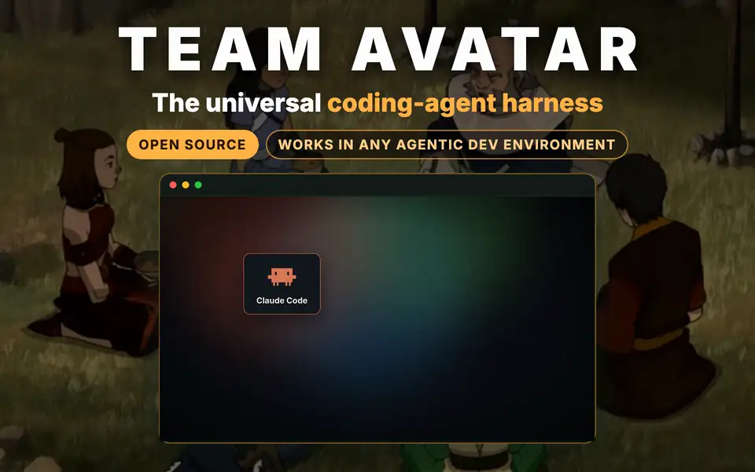
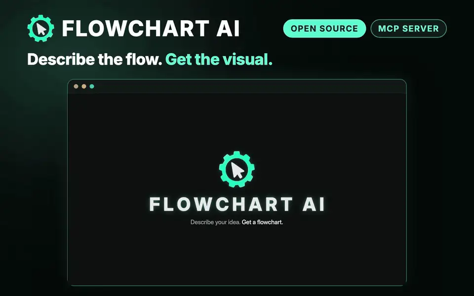

<table width="100%">
  <tr>
    <td valign="middle">
      <a href="https://x.com/hodlmecloseplz" title="X"><picture><source media="(prefers-color-scheme: dark)" srcset="https://cdn.simpleicons.org/x/ffffff"></picture></a>
      
      
      <b>Hey, I'm Trent 👋</b> 
      I run a fleet of coding agents like an engineering team, and I hold what they ship to a principal engineer's bar.
      Founder of <a href="https://zeroclickdev.ai/">Zero Click Dev</a>.
        
      
    </td>
  </tr>
  <tr>
    <td align="center">
      
       
      
      
       
      
      
       
      
      
    </td>
  </tr>
  <tr>
    <td>
      <b>how i work</b> 
      🧪 <b>Experiment fast.</b> 45+ repos started in 2026: products, MCP servers, games, client sites, and research spikes. 
      📈 <b>Hill-climb with evals.</b> I build evals and benchmarks, then climb them: UI quality, game feel, API contracts, and infrastructure. 
      🔍 <b>Quality-control the agents.</b> Review panels across models and verification against the real app before anything is called done. 
      💸 <b>Run lean.</b> I optimize cloud cost hard. Most of my projects run free on hobby tiers. 
      🖥️ <b>Ship beyond the web.</b> Native desktop apps (Tauri, Electron), iOS, and Windows builds, with CI pipelines that build them as development happens. 
      🚢 <b>Deliver end to end.</b> Code, docs, and the launch: AI-made key art, Remotion trailers, and narrated PR videos with Claude Opus. 
      🛡️ <b>Govern it.</b> AI governance, CI that agents can't skip, and maintenance loops that keep every repo current. 
      🤝 <b>Lead with humility, grace, and being genuine.</b>
    </td>
  </tr>
  <tr>
    <td>
      <b>shipping</b>  
      <a href="https://github.com/tmcfarlane/team-avatar"><b>Team Avatar</b></a>   
      A universal agent harness for developers. 9 agents and 58 skills that work in any agentic dev environment.  
      <a href="https://github.com/tmcfarlane/flowchart"><b>Flowchart AI</b></a>    
      Describe the flow, get the visual. Your agent can draw and edit charts over MCP.  
      <a href="https://github.com/tmcfarlane/zeroclickboards"><b>ZeroBoard</b></a>   
      An open-source Trello your agent can plan, track, and ship from.  
      <a href="https://replyguy.zeroclickdev.ai/"><b>ReplyGuy</b></a>  
      One-click AI replies for LinkedIn and Gmail, in your voice.  
      <a href="https://wordgarden.zeroclickdev.ai/"><b>Word Garden</b></a>  
      A local-first writing app for long-form fiction. No sign-in, bring your own AI key.  
      <a href="https://deepwell-eight.vercel.app/"><b>DEEPWELL</b></a>  
      A tactical deckbuilding roguelike on web, iOS, macOS, and Windows.  
      <a href="https://dustline-eight.vercel.app/"><b>DUSTLINE</b></a>  
      Trials-style dirt-bike racing in the browser, with touch controls and custom physics.  
      <b>Neon Felt</b>  
      Real-time multiplayer poker with an authoritative game server.
    </td>
  </tr>
  <tr>
    <td>
      

        
<b>My AI Experience Timeline</b> 2017 → today

         
        <ul>
          <li><code>2017</code> <b>Machine learning fundamentals</b> Andrew Ng's course on Coursera. <a href="https://github.com/tmcfarlane/Machine-Learning-Notes">My notes.</a>  </li>
          <li><code>2024</code> <b>AI joins the daily workflow</b> ChatGPT and GitHub Copilot.  </li>
          <li><code>2025</code> <b>Early MCP</b> Azure and Data Explorer MCP servers, AI SDK + Supabase apps. Founded Zero Click Dev.  </li>
          <li><code>Jan 2026</code> <b>🔁 Ralph loops</b> Built a full app in autonomous Ralph Wiggum iterations. Claude Code, Codex, Gemini CLI, and OpenCode in rotation.  </li>
          <li><code>Feb 2026</code> <b>Multi-agent orchestration</b> oh-my-cursor, then Team Avatar. Shipped Flowchart AI and ZeroBoard. Local models on Ollama.  </li>
          <li><code>Mar–May 2026</code> <b>Agents run marketing too</b> Social automation plus LinkedIn and publishing MCP servers. The skills era: gbrain, Matt Pocock's skills, Hermes.  </li>
          <li><code>Jun 2026</code> <b>Agentic SDLC</b> AI-assisted maintenance loops across the whole portfolio.  </li>
          <li><code>Aug–Sep 2026</code> <b>Games, built with agents</b> Plus AI-generated promo campaigns to launch them.  </li>
          <li><code>Oct–Nov 2026</code> <b>Harnesses and video</b> pstack, T3 Code, agent-browser, Remotion trailers, and narrated video walkthroughs of PRs.  </li>
        </ul>
      

    </td>
  </tr>
  <tr>
    <td>
      <b>agents i drive</b> · daily drivers: Claude Code, Codex, and OpenCode, all voice-first through SuperWhisper 
      
      
      
      
      
      
      
      
      
      
      
    </td>
  </tr>
  <tr>
    <td>
      <b>what i build with</b> 
      
      
      
      
      
      
      
      
      
      
      
      
      
      
      
    </td>
  </tr>
  <tr>
    <td>
      <b>open source i recommend</b>  
      <a href="https://github.com/michael-denyer/pstack-claude">pstack-claude</a> 
      poteto's pstack for Claude Code, Codex, Gemini, and more. Principles and playbooks for rigorous work.  
      <a href="https://github.com/t3dotgg/tstack">tstack</a> 
      Theo's agent skills, the ones he uses every day in Claude Code and Codex.  
      <a href="https://github.com/mattpocock/skills">mattpocock/skills</a> 
      skills for real engineers, straight from Matt Pocock's <code>.agents</code> directory.  
      <a href="https://github.com/garrytan/gbrain">garrytan/gbrain</a> 
      Garry Tan's opinionated agent brain for OpenClaw and Hermes.  
      <a href="https://github.com/pingdotgg/t3code">T3 Code</a> 
      Theo's app for driving Claude Code, Codex, and more from any computer or phone.  
      <a href="https://github.com/Yeachan-Heo/oh-my-claudecode">oh-my-claudecode</a> 
      teams-first multi-agent orchestration for Claude Code.  
      <a href="https://github.com/ghuntley/how-to-ralph-wiggum">Ralph Wiggum</a> 
      Geoffrey Huntley's loop technique. See also <a href="https://github.com/snarktank/ralph">snarktank/ralph</a>.  
      <a href="https://github.com/vercel-labs/agent-browser">agent-browser</a> 
      Vercel's browser automation CLI for agents.  
      <a href="https://github.com/openclaw/openclaw">OpenClaw</a> 
      the personal agent that actually does things. 🦞  
      <a href="https://github.com/anomalyco/opencode">OpenCode</a> 
      Anomaly's open-source coding agent. One of my daily drivers.  
      <a href="https://github.com/anomalyco/hex">Hex</a> 
      Anomaly's local voice dictation. Its Annotate mode records your screen while you draw and talk, then hands it to your agent.  
      <a href="https://github.com/anomalyco/strobe">Strobe</a> 
      Anomaly's tool to measure and explain performance in web pages, Electron apps, and any process. I use it for perf work.
    </td>
  </tr>
</table>
