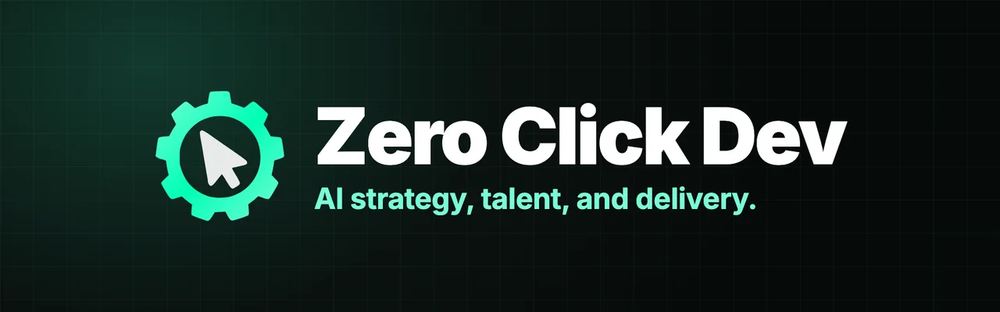
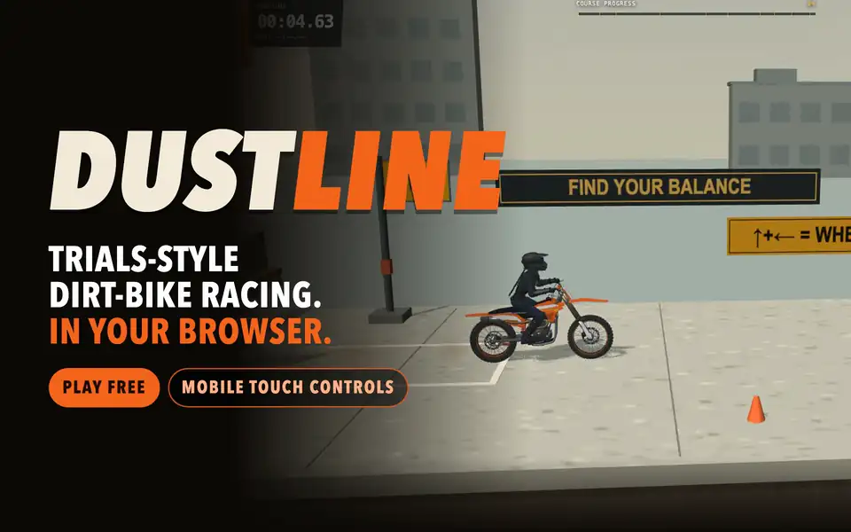
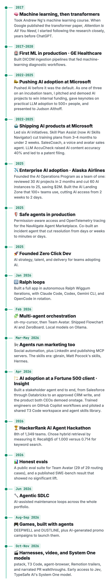

<table width="100%">
  <tr>
    <td valign="middle">
      <a href="https://x.com/hodlmecloseplz" title="X"><picture><source media="(prefers-color-scheme: dark)" srcset="https://cdn.simpleicons.org/x/ffffff"></picture></a>
      
      
      <b>Hey, I'm Trent 👋</b> 
      I run a fleet of coding agents like an engineering team, and I hold what they ship to a principal engineer's bar.
      Founder of <a href="https://zeroclickdev.ai/">Zero Click Dev</a>.
        
      
    </td>
  </tr>
  <tr>
    <td align="center">
      
       
      
      
       
      
      
       
      
      
    </td>
  </tr>
  <tr>
    <td>
      <b>how i work</b>  
      🧪 <b>Experiment fast</b> 
      45+ repos started in 2026: products, MCP servers, games, client sites, and research spikes. 
       
      📈 <b>Hill-climb with evals</b> 
      I build evals and benchmarks, then climb them: UI quality, game feel, API contracts, and infrastructure. 
       
      🔍 <b>Quality-control the agents</b> 
      Review panels across models and verification against the real app before anything is called done. 
       
      💸 <b>Run lean</b> 
      I optimize cloud cost hard. Most of my projects run free on hobby tiers. 
       
      🖥️ <b>Ship beyond the web</b> 
      Native desktop apps (Tauri, Electron), iOS, and Windows builds, with CI pipelines that build them as development happens. 
       
      🚢 <b>Deliver end to end</b> 
      Code, docs, and the launch: AI-made key art, Remotion trailers, and narrated PR videos with Claude Opus. 
       
      🛡️ <b>Govern it</b> 
      AI governance, CI that agents can't skip, and maintenance loops that keep every repo current. 
       
      🤝 <b>Lead with humility, grace, and being genuine</b> 
    </td>
  </tr>
  <tr>
    <td>
      <b>shipping</b>  
      <a href="https://github.com/tmcfarlane/team-avatar"><b>Team Avatar</b></a>   
      A universal agent harness for developers. 9 agents and 58 skills that work in any agentic dev environment.  
      <a href="https://github.com/tmcfarlane/flowchart"><b>Flowchart AI</b></a>    
      Describe the flow, get the visual. Your agent can draw and edit charts over MCP.  
      <a href="https://github.com/tmcfarlane/zeroclickboards"><b>ZeroBoard</b></a>   
      An open-source Trello your agent can plan, track, and ship from.  
      <a href="https://replyguy.zeroclickdev.ai/"><b>ReplyGuy</b></a>  
      One-click AI replies for LinkedIn and Gmail, in your voice.  
      <a href="https://wordgarden.zeroclickdev.ai/"><b>Word Garden</b></a>  
      A local-first writing app for long-form fiction. No sign-in, bring your own AI key.  
      <a href="https://deepwell-eight.vercel.app/"><b>DEEPWELL</b></a>  
      A tactical deckbuilding roguelike on web, iOS, macOS, and Windows.  
      <a href="https://dustline-eight.vercel.app/"><b>DUSTLINE</b></a>  
      Trials-style dirt-bike racing in the browser, with touch controls and custom physics.  
      <b>Neon Felt</b>  
      Real-time multiplayer poker with an authoritative game server.
    </td>
  </tr>
  <tr>
    <td>
      

        
<b>My AI Experience Timeline</b> 2015 → today

         
        <picture>
          <source media="(prefers-color-scheme: dark)" srcset="assets/timeline-dark.webp" />
          
        </picture>
      

    </td>
  </tr>
  <tr>
    <td>
      <b>agents i drive</b> 
      Daily drivers: Claude Code, Codex, and OpenCode, all voice-first through SuperWhisper. 
      
      
      
      <img src="https://img.shields.io/badge/-SuperWhisper-111?style=flat-square&logo=data%3Aimage%2Fpng%3Bbase64%2CiVBORw0KGgoAAAANSUhEUgAAAEAAAABACAYAAACqaXHeAAAABGdBTUEAALGPC%2FxhBQAAACBjSFJNAAB6JgAAgIQAAPoAAACA6AAAdTAAAOpgAAA6mAAAF3CculE8AAAAeGVYSWZNTQAqAAAACAAEARoABQAAAAEAAAA%2BARsABQAAAAEAAABGASgAAwAAAAEAAgAAh2kABAAAAAEAAABOAAAAAAAAAJAAAAABAAAAkAAAAAEAA6ABAAMAAAABAAEAAKACAAQAAAABAAAAQKADAAQAAAABAAAAQAAAAACU3PoRAAAACXBIWXMAABYlAAAWJQFJUiTwAAABnWlUWHRYTUw6Y29tLmFkb2JlLnhtcAAAAAAAPHg6eG1wbWV0YSB4bWxuczp4PSJhZG9iZTpuczptZXRhLyIgeDp4bXB0az0iWE1QIENvcmUgNi4wLjAiPgogICA8cmRmOlJERiB4bWxuczpyZGY9Imh0dHA6Ly93d3cudzMub3JnLzE5OTkvMDIvMjItcmRmLXN5bnRheC1ucyMiPgogICAgICA8cmRmOkRlc2NyaXB0aW9uIHJkZjphYm91dD0iIgogICAgICAgICAgICB4bWxuczpleGlmPSJodHRwOi8vbnMuYWRvYmUuY29tL2V4aWYvMS4wLyI%2BCiAgICAgICAgIDxleGlmOlBpeGVsWERpbWVuc2lvbj4yNTY8L2V4aWY6UGl4ZWxYRGltZW5zaW9uPgogICAgICAgICA8ZXhpZjpQaXhlbFlEaW1lbnNpb24%2BMjU2PC9leGlmOlBpeGVsWURpbWVuc2lvbj4KICAgICAgPC9yZGY6RGVzY3JpcHRpb24%2BCiAgIDwvcmRmOlJERj4KPC94OnhtcG1ldGE%2BCl6wHhsAAA4gSURBVHgB7Zr7a11VFsf3feTZp03Tprbahkalra19MLGMQsdO1R%2FGqgiCDOo%2FoT8MDAOFYWB%2BEGFgEBnwlxkUxGGgSlv6Q8WpUKcFsc%2BkL2ybPkybpqYPm8d9ZNZn7bvuPefm7pvcmwgdJpvsu8%2FZZ%2B%2F1%2BO611l77nDg3W2YRmEVgFoFZBP5%2FEUhMQ%2FXkJ7s%2FaW%2FONXcMDw%2B3J5PJedlstjWfz7dkMpnUuJS8yzv%2Bcrmck%2F5iK88nXNPHmEwmJ88y0vrq%2BzJOaCfkWkjlhvP5zP3R0exd6RuQ2n%2FgwIEB0UM41V5qBmD37t1LR4dHXxsYHNg5MDCw%2Fvbt24vv3x9uzmZVSFUCoceRZXxc%2FirXfN76ZSxQFe51rswJtVF6wmEkkUjeTKdTJ9Lp9BcCzr8EjOu1wFALAInPPvvsrUuXLv2hp6en6%2BLFi%2B7OnTu6UghVT0kkqrOfynPGpFIp19DQ4BobG883NTX9cf%2F%2B%2Ff8QeaYkVHUJClrt2rWrcfXq1X%2F67uh37x7%2Bz2FVXEzewXwyIesBpt45yNTS0uKam5vf%2B%2BGHH35%2F6tSpsclopSYZkHj99ddT3d1b%2F3zkyOF3vz74tRsdHVXEHzTl0QNLJHaIbL9cuHBh64ULFw5Mop9LTjJg%2FNVXX33r%2BPGj7xw6dEgZgPKDXu7fvy8LNfLO9u3b3xJZq7pCVQt4%2F%2F33l%2F%2F4449%2F%2F%2FLLLxey8rrqLiEUx%2BXXt05az2Nqrc2Lt7VSiY%2BPLYiIgSVkszmXTjdsfPjhh%2F955cqVu7ExkZuqy%2FnQQw%2B9dubMmVUS6Yu%2BjvIUa0sAG9DVW5sXb7ljXn2tn1X4FeWhlJOdaGxsdJXEhNeQN1TSgQeJrq6uxqGhoZcvXrygytcb6QP0i9slz3Grn8O1xsbG2B1eFhZ%2Fk0pAtNWRS19CALg333xz6eDg4LqhIb%2F6MwUA%2BzuJ0YIFC5xYmEohbuYEbDHZ9IwCAR%2Fht27Lli1Lv%2F3228umdLQNATC%2BdOnSjt7e3kWFqFpwAQCc6OsYXdyn7T4%2BWrI2N2%2FePPfCCy%2B4TZs26TWA3Lt3zx07dtzt27dXrwGCQswJ0zYe4dZJciUgLJL8oEPI9SnRsp8QAGwn7RJNmxCQRKNkAWZF8dZ7Xik2lO49R3wS5d9%2B%2B20ngUmtgJVHecqWLZtdZ%2Bcq9%2BGHH7rbt%2B%2B4BgGhRMPzqv1e8uNcvindkG6HR6USDILiO%2FNYfRSfiQqQzz33HNmak2zS3b1718kZwkk67WS%2FdpK0uNbWVvfGG28IOFlZPFLkGeAtMMoCzqukPH1BAIR5CyY7E0Jk5JywcuVKJ27lJENTiyIGzJ07V32eLRZrEJcTK%2Bh0mzdvFnBGZoQ3wKNLzQBkMvlWAJhuAUB8euPGjWLat%2FVasjQNgrgEzxiDoFgF1vDKK6%2B4puZGdROe1V%2BKc1tDNIIWIDtpsoDetFaCU%2BJjXY%2BpeeNSKD1%2F%2FnzydXUHtj%2BiNQGPWHP9%2BnUFZ8evd6iLAED9VWKSzJeFDOoZfDATykOjtXWOe%2BKJJ9xPP%2F2kSmP2%2BDqnNyqKA4Kc4vQgg0X09fW5nTt3ukWL2hC%2BbgA4YlOq5RhBAAp7aMhyptSP8GvXrtWVZQKKc1pDWUp%2Ff7%2B7ceOGKojiVIIk8WDOnDnupZd%2Bo4cvVQRL0FmlbCZ6z3WxyoV%2F5n%2BxrFAJAjBdC0D5xYvbNPiNjIzo6pvyWMOxY8fc3r17nSQo7tatW5K2jilQCIurECy3bdvmVnWuIqWVXQGtvDtUaukrVtQvjDULCwEQzAMAIApCiEC1%2FvXrNygNTJ3Vx%2B8JhCdOnHDffPONO3nylLiA0%2FcLtvqMwWQlC9Vd4vkdz7uPPvpI6VQz5UpyWACtZgFBADLyXm5cfMgCUCUGoT5Wn%2B1s2bJlGsjwexTjDdLVq1dVeaI9wCDclStXNRBi%2FmyV9JEg4QrQWLNmreQJJ5VGiGelfgOgGnBhF8iKBUgyUmuBaaMoxrZHHEFxfJ6k56K8Rjt48KD7%2Fvvv1ddTKZ%2F7NzQ2aDw4evSongmwPNyA%2FABLePrpbqUBvWIgmKJgk7lAEAALgmYBU20RfM26dRLBF2mEZ1Whde3aNcdLlcuX%2B4rbn1i6Fk4XuICc2528b3TEDEBgHrkBIG7YsMGNjY7VnCECQDUXCAKAGUdjwFQAQOD5C%2Ba7jU89pduXMUb5w4cPq%2FnLSwr1cQTzcasQ2ABBTP%2Fs2bMKhC0AMpAbsJtAG7mmIouNAeG6XMAEqLT5%2BM3Fnljr3%2F93%2F6JbAx6CAgB7OpGeLU%2FNUfpoVXuki9q09Murf90h2ClQnjjBURnL2rRxkwJAf2m%2BEvE%2FBP8iRX8DL2iEyqQW4HcUVgmevuWG%2B2iLgMuXL5eAtUYC2F1F%2Ffz58%2B748eNFBQAkifJM1elRuvSwWin1%2B7Nnz6myxA9iAYem5SuWu46ODgWDLw%2B2ysXWC1uUi62TY3pdFsAXGkW6KGgFhgqE7wfpZ555RoXL5cb1YCOv03R%2FZzURQld%2BEnoehKQ7fbpXgWuWxAlwoYElPPnkkwzhmDsRgIg8CgofiwTvugDI56vFALMGrzxJDCv%2FyCOPaLTv6Tmlpo8bEdBwBxVCLZ85Nr9yy1jyhTOnz7hmsQCjQ8JEhsjJEp58UTKr9DR18Qv05Vq2cUC3WKTIlf0EXQDU8cfKpbQ9kqaS4T377LOqPCZP0MN6YM7K0WotEvPmLiIWespbv2o9vT26%2BgxCYXt%2F0LW6q7AtegA8HWiUV0%2B%2BLgsAgFzQzIRVwdwymTHZp5%2FW93tHjhzRYAdbFIYGgpsApZWv7k7QJhYQ%2FTkrEMSwJGIBlpGThZEvVQUrqE4LOYy%2FhyP%2BG8wEy7fB%2BDR%2Fh2kuWbLEbd26VbM78neKrTgrhjLcU7iupSADGSNpNLwo9OEKuNvly5dj7xDLaRu%2FabhAwdRFcCUWbcXcMPMdO3Y4oj2CUkxZrgEgkSwpD40pV6HPXLZRkiSbZ3ShzTEbYJDDnsdbBKozCHoXyHnCcJVi60ebzWRVAILSyZMnVQgdVPhBEDX%2FRDDMRIdPvBYmSZlLKmzxxAZBm3MC2SZnB2Slb2KZfBuc1AWEcmXiYtadnZ263elKF8wcIfA5KoKx%2Fo0SyVPi03ozUcqKPSjE6pIKQ8f82BQFXA5XuAJJ1jjJkfCMFhvrXPh9QBAAmKppQbECuhx4CEj4Y3nBDUhY1m9Y765dvaaHn4GBm2IR%2FvsiyjAmqe4BRIDsY4StNjsLiZVtrSVlPDfuAQALxMdJepJlctoceRwsVQGwwFM%2BG8JUjqwARUEhqyjIF1rchFPhtl9tczn5WElE58BDy8piOaqwjGe%2FR5m2tjYNrLRkgZg6r9E5VFlghh%2F8uYeP6k1OUJCB5xRzCrMe3xv%2FDQKQ5ThcCC7xKf4uI8zZ4xHEFPer6s0Q5RCcnABFUGjFihXueQmabYsX69aGAgBogYwW00YprIvK9scugBJsg4xnjIEBkLx4xQqQJVbK72MP%2FU0QAMkERX9LNCbOJEcgNeX9PsVQNiEQEIVQAFMllz99%2BrQqTvB69NFHtXJtR2bGUtV6ZD5K4QrsAiiP4lYZg%2FK4IHxsqzP%2ByGSLI7KVMjceREoQAFFA%2FhvLzwNX76mlFv8lQrO6KEABBKzAiglDCy0ExTKYx7GXcz6WgZ%2Fj73wsJelBaWtN4WiL8hTcA1rJlAW%2FkgWw%2BPBFJqnDJlN5GwRAGA5DgGrKM7nEQg4kohTJT3t7uwpsyltbzozxVrEQlMKKeEMEkAAArcXiInw%2FoE8QlYMP%2Fzrn93vmASJZ4rlz5zT4NSR8lEPpeJkGANmRkXsICwChgqIIhJ%2BzaqxoSHkMw0gZsPamF%2FqW5pJQYc4oDz0qFsZK2ji2vUExfRYG9zCe5bLCD1oCtP8CqxTiPyELSGTGx28KQf6poLGccJSEMScg4pOUauOjc6tdGw1ro2MBA8UK5q2PKo3jgQCJDjelRg2ZR1qCAEjg6pdXVIMyallhbNVGBRKhbJnFeWQ8PMPFJIq3PnsrzY%2FfG0UDPsQFQABIdhAxllv9IoWxiQlk0SPWyY1sYQOpdLoXIhCrVm0yHBCMShrL259q1Y%2Bz8dYWkqTi%2FPi90TeeAF5RNnFf8gr5Dtn71Vdf8a%2B0FUvIAgB2WJTfIz62HT%2F%2FXyv8QwbZqFjAHtmC2QXQaUIJWQCDk5LpfS4pbx%2Bog3K82L03Vuj7nnDr55fm%2FVz3BG%2BSJ3lz1CdH5s%2BFD3oaY8%2B28FslS3YJiQP35LxPBH3JUt7Y7AfwhoViwZ6SV%2FPyVel3H3%2F88b9FTF4m1AwAE1KSaPTKkZN%2FMel%2B0F3BrJSPKI8%2F%2FvhfP%2F30079IzoD%2FBn24mgXIPP0f%2FITso4ckSWkVZLuzkpAQeB6kguLe7Fv08IXy8m%2F9u%2BTQNSJysg0Gi%2B0qwQHyAP8h120Wwr8VK3h3dHSskwMI2ZkVPF%2FiuN1WiBnFR7ELW7VYZ%2BAmOhYzp5AIEe35iNrZ2XlBzibvffDBB5%2FII1M%2BeA5gfkli7sKFcYCQEkYrZWvZKcq%2FKGCsEeQXyevpJoyiXECE1CpbKdsh12yrlVobByO9lm0QHf11gY50kG9YlSxxVJS%2FJUr3yvV%2BCXhf7Nmz55KQYGUq%2Fmeo9McK%2FGopbJtUrKJVtpklkml1iFJtshJzBYAWKs9RlNWxjI1r%2BhqS8m2wwT9LysGnAXC08h8i8QzP9xf6hGUilcgLIJxRhiUo35N2cGjoRv%2B%2BfQduCE9OSKx2VZ%2BX57FSKwBMZg4AED%2B4jtKIXsujn61EgxDXVFYdAKLP5LZ6ma7A0flcR%2B%2Brc57eU1PaqNSktE2abWcRmEVgFoH%2FArwfu1QrA41NAAAAAElFTkSuQmCC"/>
      <img src="https://img.shields.io/badge/-T3%20Code-111?style=flat-square&logo=data%3Aimage%2Fpng%3Bbase64%2CiVBORw0KGgoAAAANSUhEUgAAAEAAAABACAYAAACqaXHeAAAABGdBTUEAALGPC%2FxhBQAAACBjSFJNAAB6JgAAgIQAAPoAAACA6AAAdTAAAOpgAAA6mAAAF3CculE8AAAAeGVYSWZNTQAqAAAACAAEARoABQAAAAEAAAA%2BARsABQAAAAEAAABGASgAAwAAAAEAAgAAh2kABAAAAAEAAABOAAAAAAAAAJAAAAABAAAAkAAAAAEAA6ABAAMAAAABAAEAAKACAAQAAAABAAAAQKADAAQAAAABAAAAQAAAAACU3PoRAAAACXBIWXMAABYlAAAWJQFJUiTwAAABzWlUWHRYTUw6Y29tLmFkb2JlLnhtcAAAAAAAPHg6eG1wbWV0YSB4bWxuczp4PSJhZG9iZTpuczptZXRhLyIgeDp4bXB0az0iWE1QIENvcmUgNi4wLjAiPgogICA8cmRmOlJERiB4bWxuczpyZGY9Imh0dHA6Ly93d3cudzMub3JnLzE5OTkvMDIvMjItcmRmLXN5bnRheC1ucyMiPgogICAgICA8cmRmOkRlc2NyaXB0aW9uIHJkZjphYm91dD0iIgogICAgICAgICAgICB4bWxuczpleGlmPSJodHRwOi8vbnMuYWRvYmUuY29tL2V4aWYvMS4wLyI%2BCiAgICAgICAgIDxleGlmOkNvbG9yU3BhY2U%2BMTwvZXhpZjpDb2xvclNwYWNlPgogICAgICAgICA8ZXhpZjpQaXhlbFhEaW1lbnNpb24%2BMTAyNDwvZXhpZjpQaXhlbFhEaW1lbnNpb24%2BCiAgICAgICAgIDxleGlmOlBpeGVsWURpbWVuc2lvbj4xMDI0PC9leGlmOlBpeGVsWURpbWVuc2lvbj4KICAgICAgPC9yZGY6RGVzY3JpcHRpb24%2BCiAgIDwvcmRmOlJERj4KPC94OnhtcG1ldGE%2BCsHtO6kAAAoWSURBVHgB7VtLaFRZGv6r6lZSiUmVpSa%2BtcW0iMK0LSPO%2BJphEFQc2yCKO7Xphh4FGcGNLepqnF7oQp2dG10MiIiL0UYRxsWoozCIjbboTsdJBO2osROtR%2Bpx5%2FvOrVOp1H1U1U0pFTqHnLr3nsd%2Fvv87%2F39e90ZkPIwzMM7AOAPjDPxyGQiMVvVdu3ZF%2Bvv7O7LZbCdkxXO5XHsgEGg1DKMFVyMUCkkwGJTyK9tlmuT4hx%2BEfD4vqD%2FimsFzwDQhPps0TTOBOoMo2g%2F5P8Xj8b6zZ8%2BmVGWfP7USwPLmtm3bmnp7e1cnEonN6XT6t0NDQ58AYAzgw%2Fm8KaaZRyQiU0CCinzifelVPZT8QEH1xKtVnbKsNC2nQGYGBPzc1NT03%2Bbm5jutra3%2FmDVr1s0LFy4MQYDCWCK2vrdLliz5fdf8%2Bdc7OzvzbW1tZjgcNgHKBEAV0RoRf7Co22GbbJsYiOXTT%2Bf%2Fk9jqq22JNPR6qKur68DUqVOTkebmj6JstUSSlOZIxCQ2YiTWEuijvg1Q4Ny5c49NnDjRhA9%2BsN6tVmG3csRGjMRaIKFWF7eRpQTMnDnz22g0qkzdrfFGSadrECsxF7QZHQkwqz%2FEorFkI%2Fd8OfnEGotGU8ReIMHXJTBjxoxWTDX%2F4mBT3khDP2NMIGZipw7A6moFQQ9qzFQqtRrT3KpcNutRrAGzMHViWhZipw5AyA50DG4EkLEAhHQjBvOOVRs7kesHYqcO1KUQbaDdCGDBdlT%2BDVdmhVWNrXKjJxA7daAublhdCcAKqxNL0zl6JeYmoJHTiZ06UBc3nG4EmGCvEzE61gnI5XNR6gICHMcBw40ZKB5Hnmu%2BW71GSzfzplHQxRGal4I2v1m4cKGsWLHCUZCfRO7%2BLl68KNjMyMaNG%2F2IKNa5du2aPH%2F%2BvPhcvLH63aZLMd%2Fj5ksuKLjORhkV9%2B7dCzLrG7B2N9esWTNqoevXry%2Fi1HiJvbCA%2B9JNTy8LaAWqEfUymYx6zmSy2NqOyKr5AeAE2%2Bji3p9tcdT2E7A1dq1b2FhzMeQYvAiw5Q0TQmLsDAznl7bF84DS5%2BH70vIkhNErsD941lAatAzXulYf2nTRMpwyiGJk1xdK0wKSyaRYlmBXDAcUNiVyuaxkYTGlfBE0AWOlpg48KK%2Fv1SsxMSa4BV0Hu71iEaZhipNHjx7Jw4cPi%2BkeNzbdnCjXhf6MndUJnvBoPrDLko6ODkf58DXBiYwsWrQIiw%2BasgXuzJkzcvToURsxFJKHAr09PUrepEmTHMswk4pS%2FqlTp2Tz5m7It1wR6315%2BfKlbNiwQR48eKDklP9AB7rZPqSfRNS6FYs5WUAxkw1r5Zk4MDCgYrFA2Q2OyJQvstcZWP%2F169fy5MmTspL2RyriFQ4fPiybNm2CBSYUUfT7wcFB2bFjh6vylGfp4C7ZkwD3avYcPRBh6cnlpyqQqdMm6ptv%2FiQHDhyQ9%2B%2FfK7m0BraxZ88euX79uh1MDSl1I4BtchTXBNB4DCOjRvka8NiKdnd3w4X%2BIolEEr2ZV71P0z906JCcO3fOVr7WhDoSYG1BOaAVLSATcp2eqgG6cuVKOXHiRJFYDpxU%2FtixY3LyJF169MFtL6AkV%2FKf0uZNM6AUJwHDMeubAI72x48fV6N8MpmCbMu6OM4sWLBAdu%2FeLTj7K4XgeF9JB08CHCW6Jg5bwDABQ74JaGlpUUtkKsxRn5ELJ8bVq9fIkSNH5MqVK7Jv3z64mn9D9l%2FTgQgqToDaBTgF%2BV3dcZ%2BQTqWUBbAXaf68MrINBg6G%2B%2FfvF7wXEM4SftqqowWIMn3dS7ym08NkOPDlmURF05BBOSSWylFhEqEtjIsyTrNbt26VLVu2eMpzy6y7BXB1R7BcQRCsn14hWCq2c%2BfOotJ0Cfr8unXr1I40w8UQGiFROVjL9u3b5fLly4IzQDddHdPrSoDV6xYBbI3LLu0Ojq17JJK48gXU%2Ffv35dKlS3Lw4EHh9Mj2tEvgCFzmzZsnjx8%2F9pBqz%2FJ0AfZgLYGmSQsojX4J8GqXZwhcBQ4NpRUJek8xZcoUW7VKOnxQC%2BBWtFoCwmEDvl3d8bsaH0C0DmyHg6Yfd%2FuwBMA%2FaRXVhK%2B%2B%2BlomTJgg58%2BfF7x696yCww%2BlLGXrHk5hrfDixQvPek6ZdSeAg5DuCfZKNRaA93hqYONuE6%2B45ccfH8oPP9yTp0%2Bfytu3b5UMbntnz54ta9eulaVLlyoX0Mpzdnj27FlF4qolgAO4r8BBiQRQcZpptQSwR6nEmzdvVI9%2B9tmvoOTnynr0rMLFDmeCPPYD7969K%2FS8dSbBc4irV6%2Bq8aBW4F4WUJ1DFlrUfqkJYDIJqOQC%2BLJDli1bprbZlMHA%2BZ1B9zCveoYpT6dl3L59W27cuKHquPxoXWyd60WAhcJFolMye4vgtQuwZyoRwKXuvXv3ZPHixcoK6DIkziug3yVkhFT5mzdvql1hBVdz1cWbADCvjlAKPeMFinna9HVP8rmSMjT706dPC06HZfny5dI1v0vao%2B0ShEvAj9SpEa8MgUAQH1xZm66e3h7V63fv3lV5Tj%2FKgqwzIFcCvCb6P2Itf5nKaIWcGilNmztnjrTgjF%2BXJwCu6Pr6%2BkqLed7Tz6dNm6bi5MmT1YaI%2Fk8iaS2vcHbYg2M0vgOoRC7bZ0S5TWj0e8%2BGyzIDaHRVKBjKQADpH5OR2EPBIL8oWwUdHDvbbSUYwKjchyoDZcSMvcdAYEDpUiMBXM72wQVwZOtI3JghgjpQFzfAbhbA8oNg7j8cdMZq4HkEdaAubjq4EUCfz0PA9xCQ50Ay1gIxEzt1oC6I1lRSpogXARgIE7eMpqY7ZHKsBWI2jKY7GABvATt70JEAL72odTgej27E1JQaS7MBsRJzPBrnO%2FcwomsPen1SSsZCqVT6f9ykIPxOr%2FD40KiBph%2BJRLhv%2BGv%2F2%2F6%2FAyfN399rZ1Sk6TQjTsQ7wb%2FhQ4YR3wsgnSQ1TGTPEyOxEjMisXsOYF4WgLoqKAUT4fCtjmh0CI3wyzGj0ipMV%2F5YV64W29va0rDW716mUt9hHufyl4cRxD%2FqQB%2BKILZhT%2F7F9OnTb8RisTx2Ytb3wzixRt5HjehW1TYxEAsxERsxFrC6%2Bj3yi8HTPIqlrBuW5YASwslNDIeQK7Hm34Dd3q%2BxE5uNU9ooP0hSlgEqeEzFPQF9UofSe53mdNV7CeZpGRTDrVkAozvWJlnDCA%2Bg13vwquwu5F7F2%2BV%2F4%2BXpz6hCf6%2B654fRsbXqAt2Gu0jWNbBhieHdfgfATEHkl2VtAMR%2Fl4kgGmoKRV8AtvrXGeRbQ3LZ1Ip9ozVcIV%2B7F6%2BMICGLmEJMIPs9CO9HfIWdZB82W1Sa%2B31aIK81DXh%2BCEAbSnnWJRk0NSc5Tmko6jtQwfLAND3K896pTHmdEc%2F1Aqnl6CsbKb0f0ajPh1Ll9L2%2B%2BhQ5Xm2cgXEGfukM%2FB%2B27BonAz9pxgAAAABJRU5ErkJggg%3D%3D"/>
      
      
      
      
      
      
    </td>
  </tr>
  <tr>
    <td>
      <b>what i build with</b> 
      
      
      
      
      
      
      
      
      
      
      
      
      
      
      
      
      
    </td>
  </tr>
  <tr>
    <td>
      <b>open source i recommend</b>  
      <a href="https://github.com/michael-denyer/pstack-claude">pstack-claude</a> 
      poteto's pstack for Claude Code, Codex, Gemini, and more. Principles and playbooks for rigorous work.  
      <a href="https://github.com/t3dotgg/tstack">tstack</a> 
      Theo's agent skills, the ones he uses every day in Claude Code and Codex.  
      <a href="https://github.com/mattpocock/skills">mattpocock/skills</a> 
      skills for real engineers, straight from Matt Pocock's <code>.agents</code> directory.  
      <a href="https://github.com/garrytan/gbrain">garrytan/gbrain</a> 
      Garry Tan's opinionated agent brain for OpenClaw and Hermes.  
      <a href="https://github.com/pingdotgg/t3code">T3 Code</a> 
      Theo's app for driving Claude Code, Codex, and more from any computer or phone.  
      <a href="https://github.com/Yeachan-Heo/oh-my-claudecode">oh-my-claudecode</a> 
      teams-first multi-agent orchestration for Claude Code.  
      <a href="https://github.com/ghuntley/how-to-ralph-wiggum">Ralph Wiggum</a> 
      Geoffrey Huntley's loop technique. See also <a href="https://github.com/snarktank/ralph">snarktank/ralph</a>.  
      <a href="https://github.com/vercel-labs/agent-browser">agent-browser</a> 
      Vercel's browser automation CLI for agents.  
      <a href="https://github.com/openclaw/openclaw">OpenClaw</a> 
      the personal agent that actually does things. 🦞  
      <a href="https://github.com/anomalyco/opencode">OpenCode</a> 
      Anomaly's open-source coding agent. One of my daily drivers.  
      <a href="https://github.com/anomalyco/hex">Hex</a> 
      Anomaly's local voice dictation. Its Annotate mode records your screen while you draw and talk, then hands it to your agent.  
      <a href="https://github.com/anomalyco/strobe">Strobe</a> 
      Anomaly's tool to measure and explain performance in web pages, Electron apps, and any process. I use it for perf work.
    </td>
  </tr>
</table>
